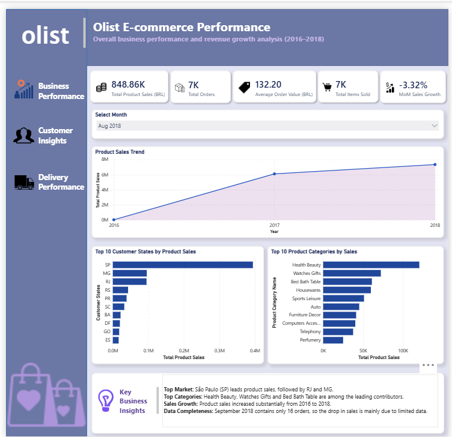
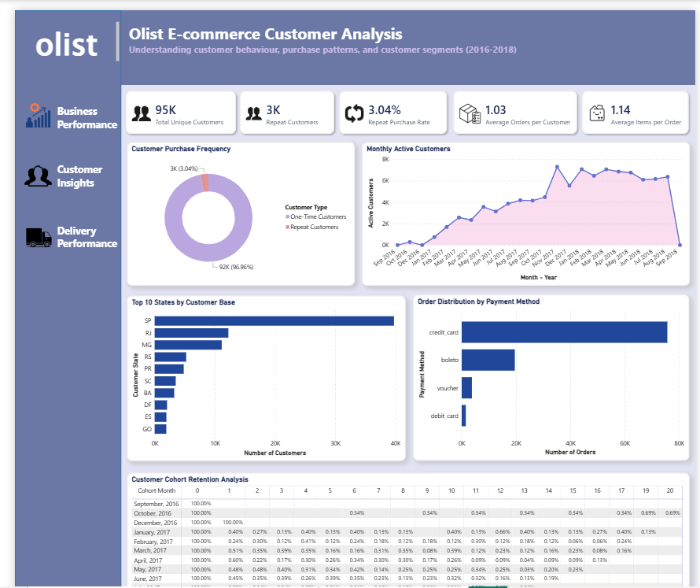
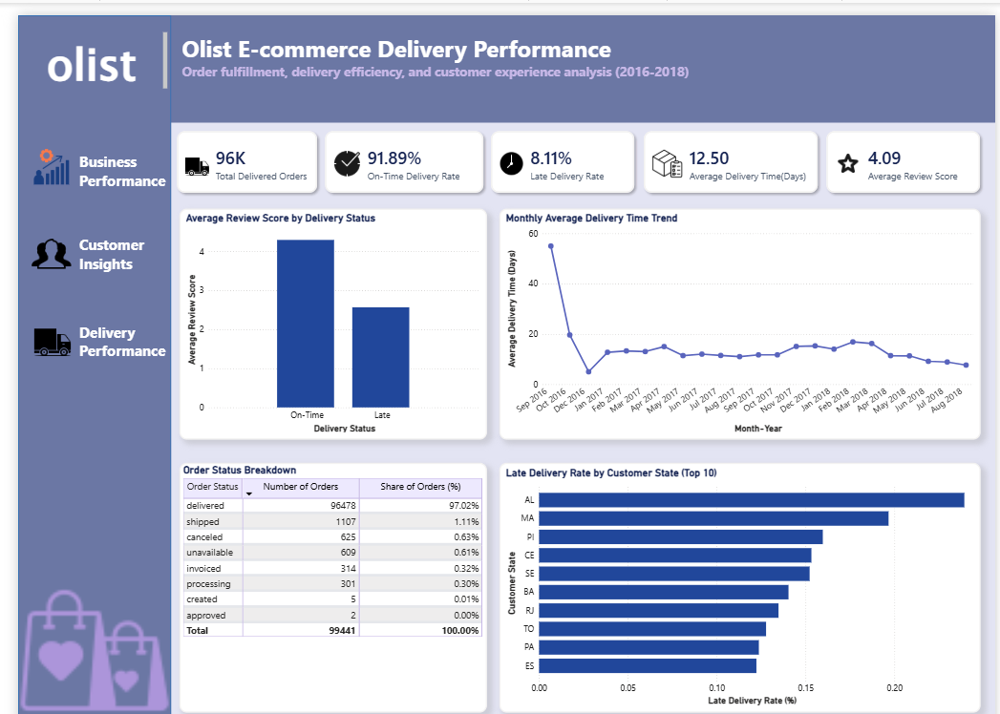
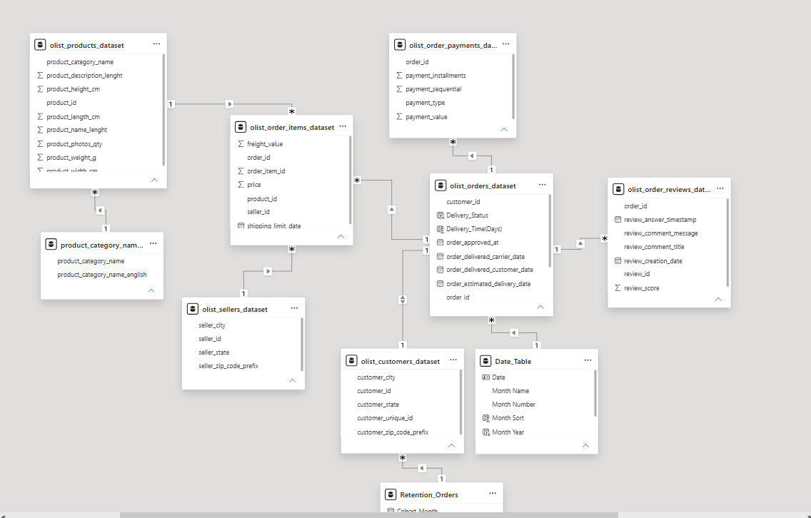

# Olist E-commerce Analytics | Power BI Dashboard

An end-to-end Power BI project analysing **~100K orders** from Olist, a Brazilian e-commerce marketplace (2016-2018). It covers data cleaning, data modelling, DAX measures, customer cohort analysis and a 3-page interactive dashboard report on sales, customers and delivery performance.

---

## Dataset

[Brazilian E-Commerce Public Dataset by Olist](https://www.kaggle.com/datasets/olistbr/brazilian-ecommerce) (Kaggle)

- ~100K orders placed between 2016 and 2018 across Brazilian marketplaces
- 9 related tables: orders, order items, customers, sellers, products, payments, reviews, geolocation, category translation

---

## Business Questions

1. **Business Performance:** How is Olist performing over time, and what drives its sales?
2. **Customer Insights:** Who are the customers, and how do they purchase and return?
3. **Delivery Performance:** How efficiently are orders delivered, and does delivery affect customer satisfaction?

---

## Key Findings, Insights and Recommendations

| Finding | Insight | Recommendation |
|---|---|---|
| Sales grew substantially from 2016 to 2018. SP leads by a wide margin, followed by RJ and MG. Health & Beauty, Watches & Gifts and Bed Bath Table are top categories. | Sales are concentrated in a few states and categories. | Keep investing in the top markets and categories, and test growth in smaller states. |
| Only **3.04%** of ~95K customers bought more than once. Cohort retention stays below 1% in most months. | Growth is driven by new customers, not repeat buying. | Add post-purchase retention efforts (follow-ups, vouchers, loyalty offers) aimed at the second purchase. |
| **91.89%** of deliveries are on time, **8.11%** late. Late orders score about **2.6** stars vs about **4.3** for on-time. | Late delivery is strongly associated with lower satisfaction. | Prioritise reducing late deliveries and set more realistic delivery estimates. |
| Late delivery rates are highest in AL, MA and PI. | Delivery performance varies by region. | Review logistics and carrier options for these states first. |
| Credit card dominates payments, followed by boleto. | Payments are concentrated in two methods. | Keep both reliable at checkout, with credit card as the priority. |

> September 2018 has only 16 orders, so the drop in sales and active customers in the last month reflects incomplete data, not a real decline.
> The delivery-satisfaction link is an association seen in this data, not proof of causation.

---

## Dashboard Pages

### Business Performance


### Customer Insights


### Delivery Performance


---

## Power BI Workflow

**1. Data cleaning (Power Query):** Checked data types, prepared date fields, removed unneeded columns, merged customer data, and separated canceled and unavailable orders from eligible orders.

**2. Data modelling:** Relational model linked on `order_id`, `customer_id`, `customer_unique_id`, `product_id` and `seller_id`, plus a Date_Table (Jan 2016 - Dec 2018) for time analysis.



**3. DAX measures:** Built around clear business definitions, using `customer_unique_id` to count real customers and keeping full-history customer metrics independent of the month slicer.

**4. Cohort analysis:** Customers grouped by first-purchase month and tracked by months since first purchase, using reference queries so source tables stayed untouched.

**5. Dashboard design:** Three pages with a consistent theme, KPI cards and interactive visuals, plus a key insights panel on the Business Performance page.

---

## Key Metrics

| Metric | Definition |
|---|---|
| Total Product Sales | Sum of item `price`, excluding canceled and unavailable orders |
| Repeat Purchase Rate | Customers with 2+ eligible orders / total unique customers |
| Retention Rate % | Retained customers in a cohort month / original cohort size |
| On-Time Delivery Rate | Delivered orders with actual date on or before estimated date |
| Late Delivery Rate | Delivered orders with actual date after estimated date |

---

## Analytical Notes

- Product sales are based on item prices, **not profit or accounting revenue**.
- Total Items Sold counts order item rows, not verified physical units.
- Customers are identified by `customer_unique_id`, not `customer_id`.
- Cohort retention is **month-specific, not cumulative**.
- Monthly Active Customers shows purchasing activity, not new customer acquisition.
- Payment method counts can overlap, since one order can have several payment records.
- Delivery metrics use delivered orders with valid dates only.
- Data covers 2016-2018, and the last months of 2018 are incomplete.

---

## Tech Stack

Power BI Desktop · Power Query (M) · DAX · Data Modelling

---

## Repository Structure

```
├── dashboard/
│   ├── page1.png
│   ├── page2.png
│   ├── page3.png
│   └── page4.png
├── Power BI/
│   └── Olist E-commerce Analytics.pbix
└── README.md
```

## How to Open

1. Download the `.pbix` file from this repository.
2. Open it in **Power BI Desktop** (Windows).
3. If prompted, point the data sources to your local copy of the Kaggle dataset.

---

## Author

**Chandni**, B.Tech Information Technology (IoT), MITS-DU Gwalior
[LinkedIn](https://www.linkedin.com/in/chandni-rajawat) · [GitHub](https://github.com/Chandni-R53)